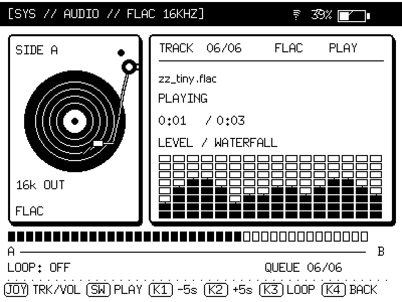

# 音乐播放器 UI 自检（v0.65.5）

## 改动
- 新增 `ui_audio.h/.cpp`：单张大圆盘唱片机（含盘外支点、配重、长唱臂、中圈唱头、末端左弯）+ 右侧垂直声音瀑布。
- `ui_theme` 新增 `segmentedBar`、`levelMeter`、`dottedDivider`、`ui::g()`。
- 音乐页顶栏：`[SYS // AUDIO // FLAC 16kHz]`。
- 主内容：
  - 左：单圆盘、白色纹槽、中心标、旋转标记。
  - 右：曲目/格式/状态/时间码/垂直电平瀑布。
  - 下：40 格分段进度 + `LOOP: OFF/ALL/ONE` + `QUEUE`。
- 底栏：`JOY TRK/VOL`、`SW PLAY`、`K1 -5S`、`K2 +5S`、`K3 LOOP`、`K4 BACK`。

## 输入
```text
摇杆 X       上一首/下一首
摇杆 Y       音量 +/-（上=+，下=-）
摇杆 SW      播放/暂停/重播
K1 / C       -5 秒
K2 / D       +5 秒
K3           循环模式 OFF → ALL → ONE
K4           返回
K4 长按 700ms 全局返回
C+D          保持全局录音优先
```

## 刷新
- UI 8 fps（`g_music_dirty` + 125ms 定时），不按 25 fps 全屏刷新。
- 音频线程/解码链路未改。

## 内存
- `ui_audio` 瀑布历史为静态 `uint8_t[16][8]`，128 字节。
- 无新增动态分配。

## 页面截图


## 未改
- ES8311/ES7210、MP3/WAV/FLAC、SD、Wi-Fi、OTA、DSH、GPIO。

## 诚实标注
- 当前没有真实 FFT：瀑布是用 `g_player_level` 的整体电平 + 确定性分频图案生成的视觉化，不是逐频段频谱。
- 8 fps 的实际观感、K4 长按抖动窗口、RLCD 残影仍需实机确认。
